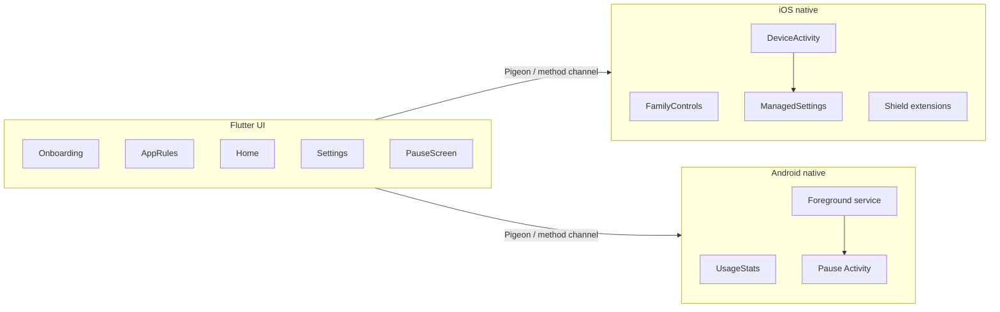

# Re-think: iOS + Play Store focus app

## Product (v1)

**Re-think** interrupts doomscrolling: when a selected app is used past **that app’s** time limit, show a **5-second warning with the user’s custom message for that app**, then **block that app** until the user taps through an unlock step.

Literal full-device lock is **not allowed** on either store (iOS has no public “lock the phone” API for third-party apps; Play rejects consumer `DevicePolicyManager.lockNow()`). v1 will feel like a lock by covering the social app with a branded pause screen / Apple shield.

**Per-app rules (the main setup):**

- User adds apps one at a time (Android presets: Instagram, TikTok, YouTube, X, Facebook, Reddit, Snapchat; plus a full installed-app list).
- For each app they set:
  - **Time limit** (default 10 minutes of continuous use).
  - **Notification title** (e.g. “That’s enough TikTok”).
  - **Notification body** (e.g. “You said you’d stop after 10 minutes. Unlock only if you still need it.”).
- Empty copy falls back to a default: “Re-think — time’s up on this app.”
- Same custom title/body appear on the 5-second warning notification **and** on the pause/shield screen so the reminder is consistent.

**Global defaults (Settings):**

- Warning duration: **5 seconds** (fixed in v1).
- Unlock grants a **2-minute cool-down** for that app before the next warning cycle.
- Local-only: no accounts, no backend.

## Architecture

Flutter is the right default for dual-store UI, but Screen Time / usage blocking **must** be native.

- **Shared Dart:** list of `AppRule` (`id`, platform app id, display label, `limitMinutes`, `notificationTitle`, `notificationBody`, enabled). Persist with `shared_preferences` or `hive`. Native layers read the same rules so the warning text is not hardcoded in Flutter only.
- **iOS:** [Family Controls](https://developer.apple.com/documentation/familycontrols) (individual auth, iOS 16+), one [DeviceActivity](https://developer.apple.com/documentation/deviceactivity) monitor **per rule** (activity name = rule id) so the extension knows which custom copy to show. [ManagedSettings](https://developer.apple.com/documentation/managedsettings) named stores per rule. Shield Configuration + Shield Action extensions. Rules + copy stored in an **App Group** so extensions can read them. iOS cannot reveal the real app name from a token — the user types a **label** (e.g. “Instagram”) when they pick the app, and that label is used in the editor and fallback notification.
- **Android:** `UsageStatsManager` polling from a `specialUse` foreground service; match foreground package to an `AppRule`; fire that rule’s notification, wait 5s, launch **Pause Activity** with the same title/body (not Accessibility Service in v1). Usage Access + overlay / full-screen intent permissions with in-app education.

Minimum OS: **iOS 16**, **Android 10** (API 29).

## Project setup (after you approve)

Neither `~/Projects` nor `~/Developer` exists, so create:

`/Users/aquibkhan/re_think`

1. `mkdir` + `git init`
2. Call `move_agent_to_root` with that path **before** any scaffolding
3. `flutter create --org com.rethink.app --project-name re_think --platforms ios,android .`
4. Add Pigeon (or a thin MethodChannel) for `requestPermissions`, `upsertAppRule` / `deleteAppRule`, `start/stopMonitoring` (native receives full rule including custom notification copy).

## Native work (the real product)

### iOS (App Store)

- Add Family Controls capability to the app + Device Activity Monitor, Shield Configuration, Shield Action targets.
- **Start the Family Controls distribution entitlement request early** (Account Holder in Apple Developer). Development works without distribution approval; TestFlight/App Store do not.
- Flow: `AuthorizationCenter.requestAuthorization(for: .individual)` → user adds a rule: label + `FamilyActivityPicker` (prefer a single app) + limit + custom title/body → start a named `DeviceActivity` whose threshold matches that rule’s minutes.
- On `eventDidReachThreshold`: read that rule’s copy from App Group, post a **5-second local notification** with that title/body, then apply `ManagedSettingsStore(named: ruleId).shield`.
- Shield Configuration shows the same custom title/body (truncated if needed) plus Unlock.
- Shield Action “Unlock” clears that named store for the cool-down window, then monitoring for that rule resumes.
- You **cannot** read real app names from tokens after pick; the user-supplied label is required.

### Android (Play)

- Permission onboarding: Usage Access (`ACTION_USAGE_ACCESS_SETTINGS`), notifications, and (if needed) display-over-other-apps. Prominent disclosure copy for Play review.
- Foreground service (`FOREGROUND_SERVICE_TYPE_SPECIAL_USE`) polls foreground package; if it matches a rule and session time ≥ that rule’s limit → notification **using that rule’s title/body**, wait 5s, start Pause Activity with the same copy.
- Pause Activity is the “locked” screen: user’s custom message, then **Unlock**. Cool-down is per app. Back/home should not silently bypass (bring Pause back if the blocked app is still foreground).
- Play Console: Data safety form, foreground-service `specialUse` justification, **do not** declare `isAccessibilityTool`.

## Flutter screens (v1)

1. **Onboarding** — why permissions exist, one screen per OS permission.
2. **Home** — monitoring on/off, list of app rules (label, limit, notification preview), today’s interruptions.
3. **Add / edit app rule** — pick app (iOS: `FamilyActivityPicker` + required label; Android: preset or installed-app list) → time limit → **notification title and body** (character limits ~50 / ~120 so they fit a system banner). Preview of how the 5-second warning will look.
4. **Settings** — default limit for new rules, cool-down minutes. Warning length stays 5s in v1.
5. **Pause** — Android full-screen with that rule’s custom text; iOS shield uses the same copy.

Keep UI simple (Material 3, one accent color). No accounts.

## Store and accounts (you, outside the repo)

- Apple Developer Program + Google Play Console.
- Bundle ID `com.aquibkhan.rethink`; Android applicationId the same.
- App Store: Screen Time / Family Controls justification; privacy nutrition labels (usage data stays on device).
- Play: usage-access / overlay declarations and a short video of the pause flow for reviewers.
- Assets: app icon, 5s warning copy, screenshots for both stores.

## Out of v1

Website blocking, parental/child Family Sharing, accounts/sync, Android Accessibility Service, actually locking the hardware lock screen, Android 15+ OEM battery-kill workarounds beyond `START_STICKY` + user battery exemption prompt.

## Verification

- iOS Simulator: limited Screen Time APIs — use a physical iPhone for Family Controls.
- Android: emulator with Usage Access granted; two rules with different copy (e.g. YouTube vs Chrome); confirm each limit fires **that app’s** title/body on the 5s warning and Pause screen, then Unlock and per-app cool-down.
- iOS device: two labeled rules with different messages; confirm the matching shield/notification text.
- Confirm monitoring survives app backgrounding (iOS via extension; Android via FGS).

---

# Status and next steps (2026-10-11)

## Done
- Flutter UI, models, persistence, Pigeon bridge.
- iOS Screen Time layer: `ios/Shared` (App Group rule store and per-rule DeviceActivity scheduler),
  plus the `DeviceActivityMonitor`, `ShieldConfiguration` and `ShieldAction` extensions. These are
  registered in the Xcode project and embedded in the app. Simulator build passes and the app launches.
- Android native layer is written (monitor service, pause screen, boot receiver) but **not compiled
  yet**: there's no Android SDK on this Mac.
- Store checklist: `docs/store-readiness.md`.

## Decisions
- **Focus on iOS first.** Android is parked until later.
- **Family Controls only.** A Shortcuts-automation approach was considered and rejected because it
  doesn't serve the app's purpose. Re-think needs real Screen Time monitoring and blocking.
- Testing in the Simulator can't exercise Screen Time (no auth, no usage events), so device testing
  waits for the developer account. An optional idea for meanwhile: a debug-only "Simulate limit
  reached" button.

## Blocked on
- Apple Developer Program enrollment (requested 2026-10-11).

## When the developer account is approved
1. In Xcode, open `ios/Runner.xcworkspace` and set the Team on all 4 targets: Runner,
   DeviceActivityMonitor, ShieldConfiguration, ShieldAction.
2. Register the bundle IDs `com.aquibkhan.rethink` and `com.aquibkhan.rethink.{DeviceActivityMonitor,ShieldConfiguration,ShieldAction}`
   with the Family Controls and App Groups (`group.com.aquibkhan.rethink`) capabilities.
3. Submit the Family Controls **distribution** request for all 4 bundle IDs. It's only needed for
   TestFlight and the App Store; device testing works without it.
4. Run on a physical iPhone. Verify: pick an app, then the 5s warning shows the custom copy, then
   the shield shows the same copy, then Unlock, then the cool-down, then the warning again. Test
   with two rules that have different messages.
5. Remaining polish: app icon, privacy policy URL, store screenshots.

## Update (2026-10-12): verified on a physical iPhone
- Developer account approved: team `NC7A2HC4R5` (individual). iOS bundle ID changed to
  `com.aquibkhan.rethink` because `com.rethink.app` was already taken. The App Group is
  `group.com.aquibkhan.rethink`.
- The full flow works on an iPhone 17 Pro: Screen Time authorization, app picker, 1-minute limit,
  custom notification, shield with the custom copy, unlock, and the cool-down re-warning.
- Device build: `xcodebuild -workspace ios/Runner.xcworkspace -scheme Runner -configuration Release
  -destination 'id=<UDID>' -allowProvisioningUpdates -allowProvisioningDeviceRegistration build`,
  then install with `xcrun devicectl device install app`.

## Next
1. Submit the Family Controls **distribution** request for the 4 `com.aquibkhan.rethink*` bundle IDs.
2. App icon, privacy policy URL, store screenshots.
3. TestFlight once distribution is approved.

## Update (2026-10-12): renamed to Recenter
- "Re-think", "Reset", "Retime", "Pause", "Break", "Instead", "Wellspent" and others were already
  used by screen-time apps. **Recenter** came up clear in App Store searches. Still reserve it in
  App Store Connect (Apps → + → New App) to make it official.
- iOS bundle ID: `com.aquibkhan.recenter` (+ `.DeviceActivityMonitor`, `.ShieldConfiguration`,
  `.ShieldAction`). App Group: `group.com.aquibkhan.recenter`. Android applicationId:
  `com.aquibkhan.recenter`.
- Kept as-is on purpose (never seen by users): the folder and Dart package `re_think`, the Kotlin
  package `com.rethink.app`, and the stored-data keys.
- Earlier `com.aquibkhan.rethink*` entries in this file are historical. The Family Controls
  distribution request should use the **recenter** IDs.

## Update (2026-10-13): ready for submission, waiting on Apple
- Family Controls **distribution** request submitted on 2026-10-13. Apple's form is now one
  team-level request (prefilled, "get entitlement"), not one per bundle ID. Waiting for the email.
- After approval: in Identifiers, open each of the 4 `com.aquibkhan.recenter*` IDs →
  **Additional Capabilities** → tick **Family Controls (Distribution)** → Save.
- Done: app icon, privacy policy and support page (GitHub Pages), App Store listing text
  (`docs/app-store-listing.md`), and four 6.9" screenshots (`assets/screenshots/app-store/`).
- Next, once approved: create the App Store Connect record (if not already done), archive, upload
  to TestFlight, test, then submit for review.

## Update (2026-10-15): Family Controls distribution approved
- Approved. Family Controls (Distribution) is enabled on all 4 IDs.
- A local App Store export (`xcodebuild archive` + `-exportArchive` with method
  `app-store-connect`, destination `export`) succeeded. It's signed with Apple Distribution, and all
  4 bundles carry the family-controls and App Group entitlements. Nothing uploaded yet.
- Next: App Store Connect app record, then upload to TestFlight, test, then submit for review.

## Update (2026-10-15): first TestFlight upload
- Version 1.0.0 (build 1) uploaded to App Store Connect. `ITSAppUsesNonExemptEncryption = false`
  is in Info.plist, so there's no export-compliance prompt.
- Every future upload needs a higher build number: bump `version:` in pubspec.yaml
  (e.g. `1.0.0+2`).
- Upload: archive as above, then `xcodebuild -exportArchive` with
  `build/ios/archive/UploadOptions.plist` (method `app-store-connect`, destination `upload`).
